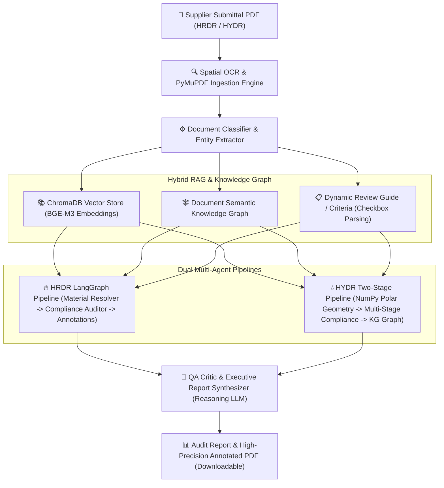

# QDR·AI — Agentic Quality Document Review System

**QDR·AI** is an industrial-grade, multi-agent AI system designed for automated quality assurance and regulatory compliance review of heavy plant engineering supplier documentation:
1. **HRDR Submittals (Hardness Review Document Reports)**: Automated spatial OCR table extraction, deterministic material grade resolution (P91, P22, P11, CS), hardness limit verification against project specifications (e.g. Spec 700-006 Table 8), and annotated PDF generation.
2. **HYDR Submittals (Hydrostatic Pressure Test Reports)**: Deterministic cross-page semantic reconciliation between Sheet 1 manual inspection tables, Sheet 2 visual pressure/time charts, high-precision gauge pointer angle ($\theta$) calculations via pure NumPy/PIL computer vision, water chemistry compliance (chlorides, pH, hardness), and top-of-page defect summary annotations.

The system combines **Deterministic Rule Engines**, **Hybrid RAG (BGE-M3 1024-dim Vector Store + Document Knowledge Graph)**, and **Local Reasoning LLMs (Qwen 2.5 via Ollama)** for 100% reproducible, explainable audits.

---

## Architecture Overview



---

## GPU Machine Prerequisites

| Component | Minimum Specification | Recommended Specification |
|---|---|---|
| **GPU** | NVIDIA GPU with >= 8 GB VRAM (e.g. RTX 3080/4080, T4) | NVIDIA GPU with >= 16 GB VRAM (RTX 3090/4090, A100, L4, V100) |
| **CUDA Version** | CUDA 12.4+ (PyTorch >= 2.6 is mandatory — see Step 3) | CUDA 12.4 |
| **Operating System** | Ubuntu 22.04 / 24.04 LTS, Debian 12, or Windows Server | Ubuntu 22.04 LTS |
| **Python** | Python 3.10+ | Python 3.11 or 3.12 |
| **RAM** | 16 GB System Memory | 32 GB+ System Memory |
| **Storage** | 20 GB Free Disk Space (Models + Vectorstore) | 50 GB NVMe SSD |

---

## GPU Machine Deployment & Setup Guide

### Step 1: Verify NVIDIA Driver & CUDA Toolkit
Check that NVIDIA drivers and CUDA are accessible on your host:
```bash
nvidia-smi
nvcc --version
```

---

### Step 2: Clone Repository & Create Virtual Environment

```bash
# Clone repository
git clone <your-repo-url>
cd QDR-V2/QDR-AI

# Create virtual environment
python3 -m venv .venv

# Activate virtual environment
# On Linux / macOS:
source .venv/bin/activate

# On Windows (PowerShell):
# .venv\Scripts\Activate.ps1
```

---

### Step 3: Install PyTorch with GPU / CUDA Support
Install PyTorch compiled with the matching CUDA runtime (CUDA 12.4 recommended):
```bash
pip install --upgrade pip setuptools wheel
pip install torch torchvision --index-url https://download.pytorch.org/whl/cu124
```

> **`torch >= 2.6` is mandatory, not merely recommended.** `transformers >= 5`
> refuses to run `torch.load()` on `.bin` checkpoints under older PyTorch
> (CVE-2025-32434). The `main` revision of `BAAI/bge-m3` ships weights only as
> `pytorch_model.bin`, so on `torch 2.5.x` the embedding model fails to load and
> **all RAG retrieval is unavailable** — `src/vectorstore/embeddings.py` raises
> `EmbeddingModelError` rather than silently falling back to random vectors.
> The `cu121` wheel index tops out at `torch 2.5.1`, which is why `cu124` is required.

Verify that PyTorch recognizes your GPU:
```bash
python -c "import torch; print('Torch:', torch.__version__); print('CUDA Available:', torch.cuda.is_available()); print('Device Name:', torch.cuda.get_device_name(0) if torch.cuda.is_available() else 'CPU Only')"
```

---

### Step 4: Install Application Dependencies
Install the remaining core dependencies from `requirements.txt`:
```bash
pip install -r requirements.txt
```

---

### Step 5: Install Native Tesseract OCR Engine

#### Ubuntu / Debian:
```bash
sudo apt update
sudo apt install -y tesseract-ocr libtesseract-dev tesseract-ocr-eng
which tesseract  # Usually /usr/bin/tesseract
```

#### Windows:
1. Download and run the [UB Mannheim Tesseract Installer](https://github.com/UB-Mannheim/tesseract/wiki).
2. Default path: `C:\Program Files\Tesseract-OCR\tesseract.exe`.

---

### Step 6: Install and Configure Ollama on GPU

#### 1. Install Ollama:
```bash
# On Linux:
curl -fsSL https://ollama.com/install.sh | sh

# On Windows: Download installer from https://ollama.com/download
```

#### 2. Configure Ollama for GPU Acceleration & External Binding:
Edit Ollama service environment or launch with:
```bash
export OLLAMA_HOST=0.0.0.0:11434
export OLLAMA_NUM_GPU=1
export CUDA_VISIBLE_DEVICES=0
ollama serve &
```

#### 3. Pull Required Reasoning & Vision LLMs:
```bash
ollama pull qwen2.5:7b-instruct
ollama pull qwen2.5:3b
ollama pull qwen2.5vl:7b
```

Verify GPU allocation:
```bash
ollama ps
```

---

### Step 7: Environment Configuration (`.env`)
Create `.env` from `.env.example`:
```bash
cp .env.example .env
```

Edit `.env` to match your GPU server environment:
```ini
# ── Ollama Host Configuration ──
OLLAMA_LOCAL_HOST=http://localhost:11434
OLLAMA_GPU_HOST=http://localhost:11434
OLLAMA_FORCE_LOCAL=true

# ── Primary Models ──
DEFAULT_LLM_MODEL=qwen2.5:7b-instruct
REASONING_MODEL=qwen2.5:7b-instruct
OLLAMA_MODEL=qwen2.5:7b-instruct
OLLAMA_LOCAL_MODEL=qwen2.5:3b
OLLAMA_VISION_MODEL=qwen2.5vl:7b

# ── Embedding Model & GPU Acceleration ──
EMBEDDING_MODEL=BAAI/bge-m3
EMBEDDING_DEVICE=cuda

# ── OCR Binary Path ──
# Linux: /usr/bin/tesseract | Windows: C:\Program Files\Tesseract-OCR\tesseract.exe
TESSERACT_CMD=/usr/bin/tesseract

# ── Web Services ──
QDR_BACKEND_HOST=0.0.0.0
QDR_BACKEND_PORT=8001
STREAMLIT_PORT=8501
CHROMA_PERSIST_DIR=./data/chromadb
```

---

### Step 8: Launch Services

You can run both services in separate terminals or as background daemons:

```bash
# Terminal 1 — Start FastAPI Backend (Port 8001)
python -m uvicorn src.api.main:app --host 0.0.0.0 --port 8001

# Terminal 2 — Start Streamlit Frontend (Port 8501)
python -m streamlit run app.py --server.port 8501 --server.address 0.0.0.0
```

#### Service URLs:
- **Streamlit Web UI**: `http://<GPU-HOST-IP>:8501`
- **FastAPI REST API**: `http://<GPU-HOST-IP>:8001`
- **Interactive API Docs**: `http://<GPU-HOST-IP>:8001/docs`

---

## Production Deployment (Linux Systemd Services)

For continuous production uptime on your GPU server, configure systemd unit files:

### 1. FastAPI Service (`/etc/systemd/system/qdr-api.service`):
```ini
[Unit]
Description=QDR-AI FastAPI Backend Service
After=network.target

[Service]
Type=simple
User=ubuntu
WorkingDirectory=/home/ubuntu/QDR-V2/QDR-AI
Environment="PATH=/home/ubuntu/QDR-V2/QDR-AI/.venv/bin"
ExecStart=/home/ubuntu/QDR-V2/QDR-AI/.venv/bin/python -m uvicorn src.api.main:app --host 0.0.0.0 --port 8001 --workers 2
Restart=always
RestartSec=5

[Install]
WantedBy=multi-user.target
```

### 2. Streamlit UI Service (`/etc/systemd/system/qdr-ui.service`):
```ini
[Unit]
Description=QDR-AI Streamlit Web Application
After=network.target

[Service]
Type=simple
User=ubuntu
WorkingDirectory=/home/ubuntu/QDR-V2/QDR-AI
Environment="PATH=/home/ubuntu/QDR-V2/QDR-AI/.venv/bin"
ExecStart=/home/ubuntu/QDR-V2/QDR-AI/.venv/bin/python -m streamlit run app.py --server.port 8501 --server.address 0.0.0.0 --server.headless true
Restart=always
RestartSec=5

[Install]
WantedBy=multi-user.target
```

### Enable & Start Services:
```bash
sudo systemctl daemon-reload
sudo systemctl enable --now qdr-api qdr-ui
sudo systemctl status qdr-api qdr-ui
```

---

## Project Directory Layout

```
QDR-AI/
├── app.py                     # Streamlit frontend user interface
├── requirements.txt           # Python dependency specifications with GPU notes
├── README.md                  # Comprehensive deployment & user guide
├── DOCUMENTATION.md           # Deep architectural specification & schema reference
├── .env.example               # Template environment configuration
│
├── src/
│   ├── config.py              # Environment variable parser & model fallback engine
│   ├── api/
│   │   └── main.py            # FastAPI REST backend endpoints
│   ├── agents/
│   │   ├── orchestrator.py    # HRDR LangGraph pipeline coordinator
│   │   ├── hydro_orchestrator.py # HYDR multi-stage inspection pipeline coordinator
│   │   ├── ocr_extractor.py   # Spatial OCR table parser & page classifier
│   │   ├── material_resolver_agent.py # Deterministic + LLM material classifier
│   │   ├── compliance_auditor_agent.py # Hardness limit specification auditor
│   │   ├── gauge_cv_geometry.py # OpenCV & NumPy polar gauge geometry engine
│   │   ├── annotation_builder.py # Finding to coordinate callout builder
│   │   └── report_synthesizer_agent.py # Executive summary synthesis LLM
│   ├── knowledge_graph/
│   │   └── document_graph_builder.py # Deterministic multi-page relationship engine
│   ├── vectorstore/
│   │   └── chroma_manager.py  # ChromaDB vector store manager & BGE-M3 loader
│   ├── ingestion/
│   │   ├── parser.py          # PDF PyMuPDF/OCR parser with persistent disk cache
│   │   ├── chunker.py         # Parent-child document chunker
│   │   └── annotator.py       # High-precision 2D Pillow PDF annotation engine
│   └── utils/
│       ├── logger.py          # Structured rich logger
│       └── metrics.py         # Latency & stage tracking metrics
│
└── data/
    ├── documents/             # Uploaded and reference submittal PDFs
    ├── chromadb/              # Persisted vector index
    ├── parsed/                # Temporary inspection results & caches
    └── logs/                  # Append-only audit trails & stage traces
```

---

## REST API Reference

| Method | Endpoint | Description |
|---|---|---|
| `GET` | `/` | System status and API health summary |
| `GET` | `/health` | Active LLM, GPU, and embedding model availability |
| `POST` | `/inspect` | Runs full inspection on uploaded PDF and metadata payload |
| `POST` | `/inspect/annotated-pdf` | Executes inspection and returns the annotated PDF stream directly |
| `GET` | `/search` | Queries ChromaDB for specification clauses with score thresholds |
| `GET` | `/logs` | Tails live pipeline execution logs |

---

## GPU Performance Optimization Tips

1. **Embedding Acceleration**: `BAAI/bge-m3` automatically leverages CUDA when PyTorch CUDA is installed, speeding up retrieval from ~75s on CPU to `< 0.8s` on GPU.
2. **Ollama GPU Offloading**: Ensure `OLLAMA_NUM_GPU=1` so LLM weights are resident in VRAM, enabling generation speeds of `60-120 tokens/sec`.
3. **OCR Disk Caching**: Parsed page OCR outputs are hashed and persisted in `data/parsed/doc_cache/`. Submittals with identical content load in `< 10ms`.
4. **Parallel Annotation Engine**: `src/ingestion/annotator.py` uses a multi-threaded parallel worker to render annotated PDF pages in `< 1.8s`.

---

## Troubleshooting

- **`CUDA out of memory`**: Lower `OLLAMA_ANALYZER_NUM_CTX` in `.env` (default `8192`) or switch `DEFAULT_LLM_MODEL` to `qwen2.5:3b`.
- **`TesseractNotFoundError`**: Verify `which tesseract` and set `TESSERACT_CMD` in `.env` to the exact binary path.
- **`Connection refused to Ollama`**: Ensure Ollama is running (`curl http://localhost:11434/api/tags`) and bound to `0.0.0.0:11434`.
- **`Port 8501 or 8001 already in use`**: Terminate conflicting processes (`fuser -k 8501/tcp 8001/tcp` on Linux).
- **`EmbeddingModelError: Failed to load embedding model BAAI/bge-m3`** citing
  `CVE-2025-32434` or *"upgrade torch to at least v2.6"*: the installed PyTorch is
  older than 2.6. Reinstall from the `cu124` index (Step 3). Retrieval is hard-failed
  by design here — the pipeline refuses to continue with random vectors, because that
  would invalidate every retrieved citation while still looking genuine.
- **UI reports the backend is unreachable**: the Streamlit sidebar defaults its
  `BACKEND URL` to `http://localhost:<QDR_BACKEND_PORT>` (`8001` by default). Confirm
  `uvicorn` is actually bound to that same port — starting it on a different port
  leaves the UI pointing at nothing.
